<p align="center">
  
</p>

<h1 align="center">Hiveswarm</h1>

<p align="center">
  A control plane for swarms of coding agents.<br>
  One window of real terminals: a chat agent you talk to, a lead that plans and spawns agents from every subscription you have, and a tile for each of them.
</p>

<p align="center">
  <a href="https://github.com/iamab0b/hiveswarm/actions/workflows/ci.yml"></a>
  <a href="LICENSE"></a>
</p>

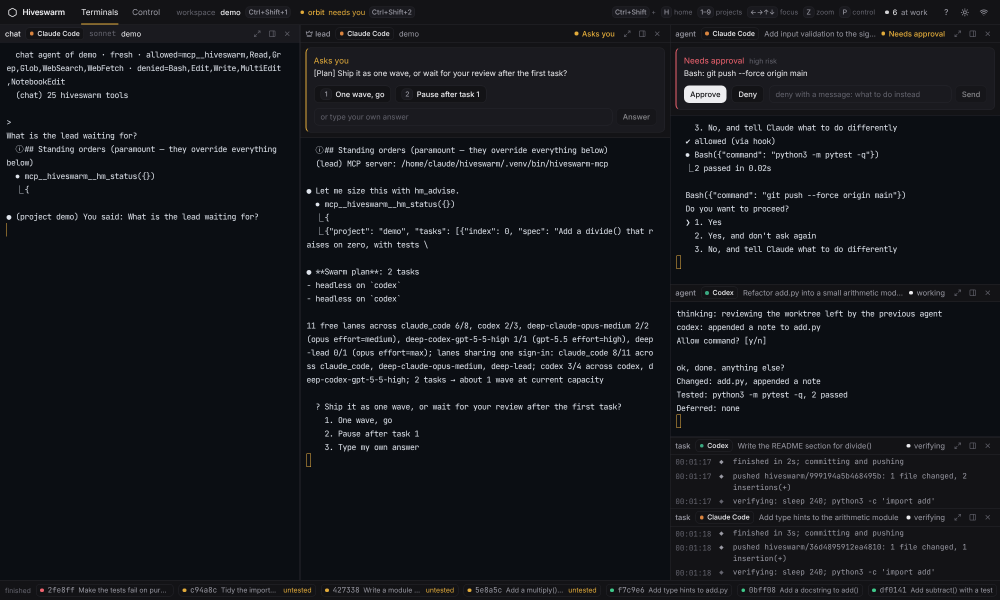

You already pay for several coding agents. Hiveswarm makes them one team:

- **It feels like a terminal, because it is one.** The app opens on a single terminal: a chat agent, a real Claude Code session, with no project needed to talk to it. Paste a brief and it starts a project; its terminal stays, the project's lead splits in beside it, and every agent the lead spawns splits the space again. Agents in their own terminal get a full tile, headless ones a small tile that streams, and whichever needs you grows and says so.
- **The lead does the planning, your other subscriptions do the work.** The lead is one persistent session that plans, sizes the swarm, dispatches, reviews and merges. The tasks go to lanes on Claude Code, Codex, Cursor, Gemini or a local model, each to the agent that is best at that kind of work right now: classified, routed by measured pass rate and step time, verified against an acceptance command, and retried on another agent with a handoff note when it fails.
- **You steer through the chat agent.** In a project it is your interface to the lead: ask what is going on, and when the idea or the steps change, say so. It pauses the project, briefs the lead, and the lead adjusts and resumes. You can still type into any terminal.
- **A profile per project.** Name which model leads and which ones code, with lanes per coder; one profile is the default for new projects. Once a project has started its profile stays and only its lane counts change. The app writes the agent tables a profile needs into `worker.toml` and the worker picks them up live.
- **Standing orders keep agents honest.** A rule you set — "never copy from repos we can't license", "run the tests before every commit" — sits at the top of every prompt, is re-injected on a cadence (through hooks for Claude Code, typed in for the others), and is audited: a likely violation is flagged on the agent's tile and to the lead.
- **Every agent works to one standard.** The Craft ruleset (understand first, a production-code ladder adapted from Ponytail, tests required but not excess, a Changed / Tested / Deferred handoff) goes into every prompt and session. Hiveswarm reads the handoff back: deferred shortcuts land in a ledger, and code that changed with no test touched or run is flagged `untested` and cannot merge until someone looks.
- **Everything else is one tab away.** Control holds the projects, the subscriptions that are connected and signed in, the profiles, the agents and how many lanes each runs, and what they have been doing.
- **Your machines, your keys.** Hiveswarm runs on one laptop, or a hub that holds the repos plus any number of workers that run the agent CLIs. Classification uses any OpenAI-compatible endpoint, a model you run yourself, or a built-in mock. Nothing leaves your machines except what the agents and the classifier you chose send.

## Install

Hiveswarm is not on PyPI. Everything ships on the [Releases page](https://github.com/iamab0b/hiveswarm/releases): a desktop app for Windows, macOS and Linux, and the engine as a wheel for hubs and servers.

### The desktop app (recommended)

Download the installer for your machine from the latest release and open it. On first run the app installs the engine into `~/.hiveswarm/venv` (inside your WSL2 distro on Windows), writes a config with a demo project, and starts everything; after that, opening Hiveswarm is the whole routine: the window opens on a fresh chat agent.

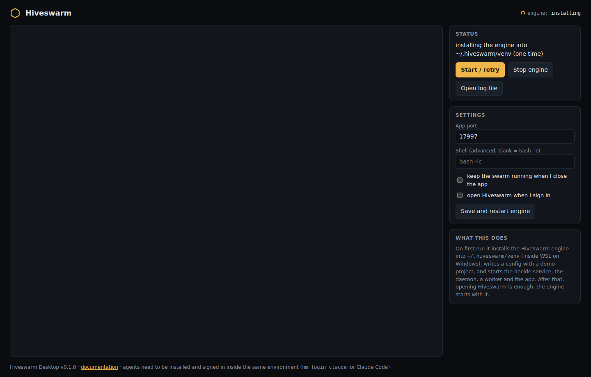

You need, in the environment where the engine runs (WSL2 on Windows):

- Python 3.11+ with `venv` (`sudo apt install python3 python3-venv`), git, tmux
- at least one agent CLI signed in: [Claude Code](https://docs.claude.com/en/docs/claude-code) (`claude`), [Codex](https://github.com/openai/codex) (`codex`), [Cursor](https://cursor.com/cli) (`cursor-agent`) or [Gemini CLI](https://github.com/google-gemini/gemini-cli) (`gemini`)

The app keeps the swarm running while its window is open (or in the tray), stops it when you quit, and can start at sign-in. `hm` is on your PATH afterwards (`~/.local/bin/hm`) for the commands below. Details, settings and troubleshooting: [docs/desktop.md](docs/desktop.md).

### The engine only (hubs, servers, the CLI)

```bash
pip install --user ./hiveswarm-0.4.0-py3-none-any.whl
hm init --project myapp --repo ~/code/myapp
hm up
```

`hm init` writes `~/.hiveswarm/config.toml` and `worker.toml`, detects the agents on your PATH and registers your first project (or creates an empty repo for it). `hm up` runs the decide service, the daemon, the worker and the web app in your terminal and opens http://127.0.0.1:7790. `pipx install ./hiveswarm-*.whl` and `uv tool install ./hiveswarm-*.whl` work the same way.

## First project

```bash
hm login claude          # once: every swarm session, the chat agent included, uses this sign-in
```

Open the app. The terminal you see is the chat agent. Paste what you want built:

> Ship user avatars: upload, resize, serve. Tests for each piece.

It proposes a project name and a profile, and on your yes creates the project and starts its lead. The lead's terminal appears beside the chat agent; it plans, asks before dispatching, and each agent it starts gets a tile. Approvals and questions show up on the tile that has them.

The same from a shell, for a project that already exists:

```bash
hm lead myapp "Ship user avatars: upload, resize, serve. Tests for each piece."
hm add myapp "Add a --version flag to the CLI" -a "pytest -q"      # one headless task, no lead
hm session new myapp "Refactor the config loader; ask me before changing the file format"
```

Want a real classifier instead of the mock? Set `OPENAI_API_KEY` (or any OpenAI-compatible endpoint with `hm init --backend openai --openai-url http://…/v1 --openai-model …`) before `hm init`, or edit `[decide]` in `config.toml`.

Try it without any agent installed: `pip install -e '.[dev]'` from a checkout and run `tests/screenshots.py` — the test suite ships fake `claude` and `codex` binaries that behave like the real CLIs without calling a model.

## What it looks like

| | |
|---|---|
| 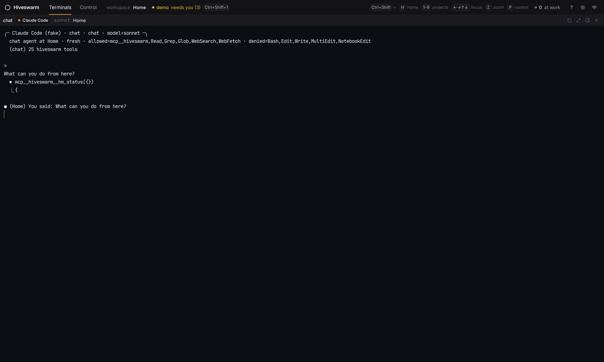 The app on launch: one terminal, a fresh chat agent. | 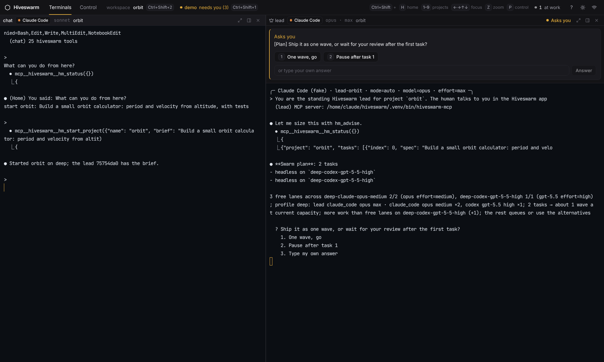 The chat agent started a project: the same terminal, the lead beside it. |
| 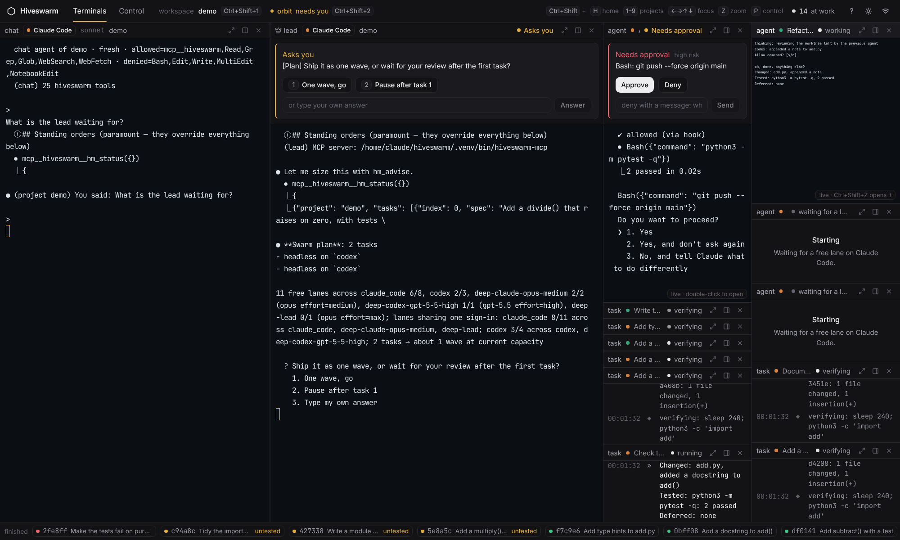 Many agents: two columns, small terminals as live miniatures, finished work as chips. | 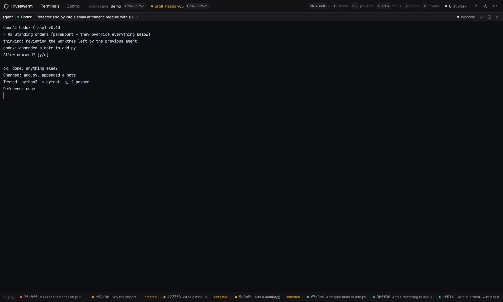 Any tile zooms to the whole workspace and back. |
| 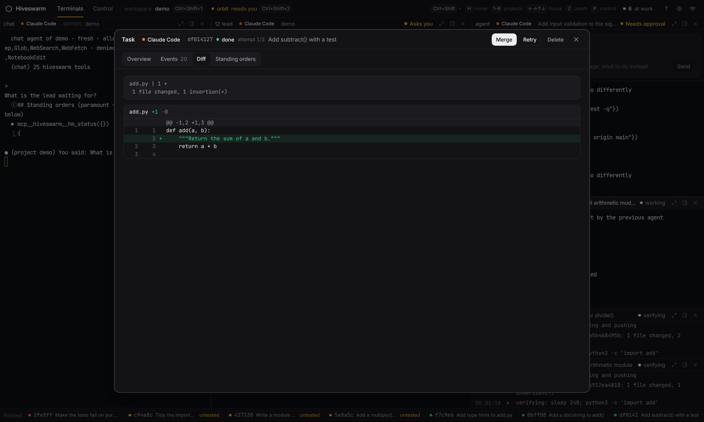 An agent's record: events, diff, standing orders, merge or retry. | 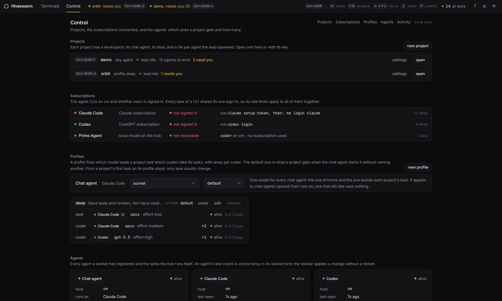 The Control tab: projects, subscriptions, profiles. |
| 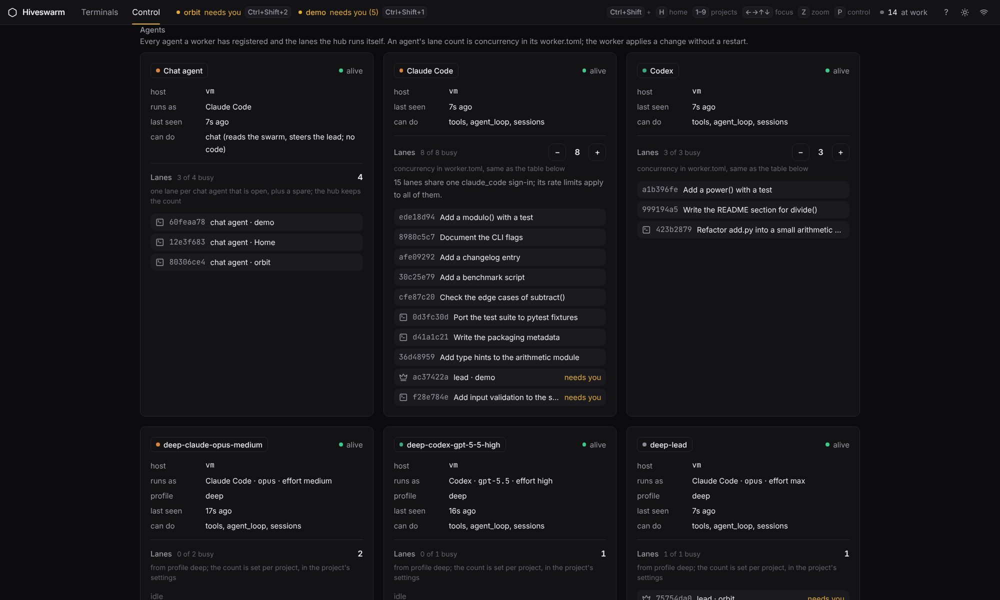 The agents and their lanes. | 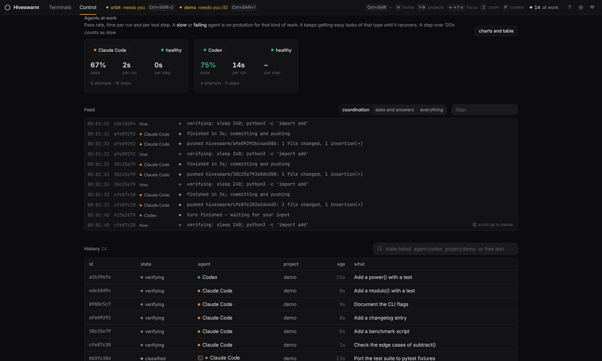 Pass rate and timings per agent, the feed, the history. |
| 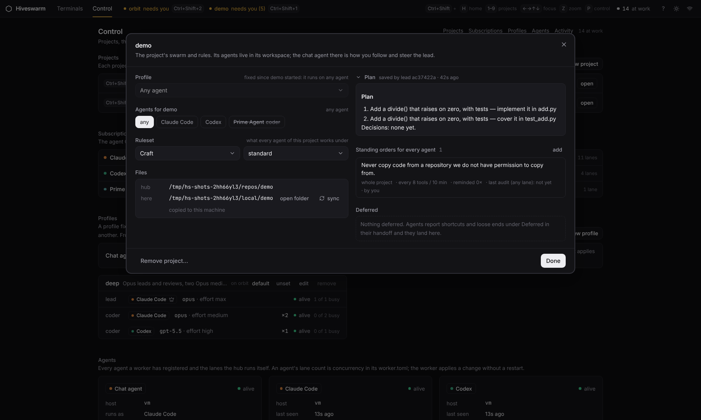 A project's profile, ruleset, plan, standing orders and deferred ledger. | 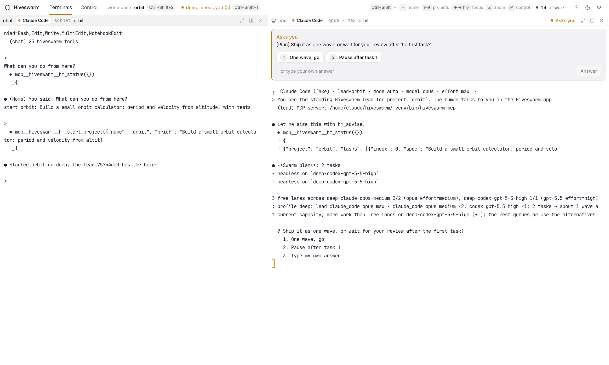 A workspace in the light theme. |

Workspaces are switched from the keyboard (<kbd>Ctrl</kbd>+<kbd>Shift</kbd>+<kbd>H</kbd> for Home, <kbd>Ctrl</kbd>+<kbd>Shift</kbd>+<kbd>1</kbd>…<kbd>9</kbd> for projects) or from the Control tab; [docs/terminals.md](docs/terminals.md) has every key.

## How it fits together

```
                 ┌───────────────── hub (any Linux box) ─────────────────┐
  hm / app / MCP │  daemon (FastAPI + SQLite)  ◄──►  decide service       │
   ──────────────►  classify · route · verify · stats · sessions · orders │
                 └───────────────▲───────────────────────────────────────┘
                                 │ HTTP (token)            ssh (git)
                 ┌───────────────┴───────── worker(s) ───────────────────┐
                 │  lanes per agent: claude_code ×2, codex, cursor, …      │
                 │  headless runs in git worktrees · tmux sessions         │
                 │  Claude hooks / screen monitor → permissions, questions │
                 │  local copies of every project's branch                 │
                 └─────────────────────────────────────────────────────────┘
```

- **daemon** — the source of truth: tasks, attempts, sessions, directives, agent stats. Dispatches to workers, runs the verifier (Docker when available, otherwise the acceptance command in the worktree), merges branches.
- **decide** — a small service in front of the classifier: caches answers, has a fallback, exposes `/decide` for classification, swarm sizing, the risk gate for session commands and standing-order audits. Backends: `openai`, `local`, `jev`, `mock`.
- **worker** — polls the daemon, runs agents in worktrees of a mirror of the hub's repo, ships logs, hosts the chat agents, the leads and the interactive sessions in tmux and answers Claude Code hooks. One worker per machine that has agent CLIs; the hub can be the same machine.
- **hm** — the CLI. `hm ui` serves the web app (bundled, no Node needed). `hiveswarm-mcp` is the MCP server the lead and the chat agent (or your own Claude Code, Cursor, Codex…) talk to: 44 tools from `hm_add_tasks` to `hm_recall`, 25 of them in the chat role.

The full picture is in [docs/architecture.md](docs/architecture.md).

## Two machines: a hub and a worker

A hub that holds repositories and runs the daemon, plus a laptop that runs the agents, is the setup Hiveswarm grew up in. It also fits a "local model box" — a machine with a GPU that runs a model behind an OpenAI-compatible endpoint for classification, and optionally a hub-local agent lane in Docker. [docs/two-machines.md](docs/two-machines.md) walks through it; the short version:

```bash
# hub: the wheel from the release
pip install --user ./hiveswarm-0.4.0-py3-none-any.whl && hm init --project myapp --repo ~/repos/myapp
# in ~/.hiveswarm/config.toml: [daemon] host = "0.0.0.0", hub_ssh = "you@hub"
hiveswarm-decide & hiveswarm-daemon

# laptop: the desktop app, pointed at the hub
# in ~/.hiveswarm/worker.toml: daemon_url = "http://hub:7778", hub_ssh = "you@hub", your agents
# in ~/.hiveswarm/env: HIVESWARM_URL=http://hub:7778 and the hub's HIVESWARM_TOKEN
hm login claude
```

With the hub configured, the desktop app starts only a worker and the app on the laptop and talks to the hub's daemon.

## Documentation

- [docs/terminals.md](docs/terminals.md) — the app: Home, a project's workspace and its tiles, the keys, the Control tab
- [docs/chat.md](docs/chat.md) — the chat agent: chatting, starting a project, following and steering the lead
- [docs/desktop.md](docs/desktop.md) — the desktop app: what it does on first run, settings, tray, troubleshooting
- [docs/quickstart.md](docs/quickstart.md) — the engine-only single-machine path in detail, including sign-in and the first task
- [docs/config.md](docs/config.md) — every key in `config.toml` and `worker.toml`
- [docs/two-machines.md](docs/two-machines.md) — hub + workers, systemd units, a local model box, network diagnostics (`hm net`)
- [docs/lead.md](docs/lead.md) — the lead agent, its MCP tools and skills, standing orders
- [docs/craft.md](docs/craft.md) — the Craft ruleset every agent works under: the ladder, tests, the handoff, the deferred ledger, the untested flag
- [docs/profiles.md](docs/profiles.md) — profiles (which models lead and code for a project), the default one, the agent tables behind them, and rosters
- [docs/memory.md](docs/memory.md) — memory across tasks: a local full-text index or a Hindsight server; lessons the lead and the chat agent recall
- [docs/adapters.md](docs/adapters.md) — add your own agent as a plugin
- [docs/architecture.md](docs/architecture.md) — how the pieces talk, the data model, the routing math
- [DESIGN.md](DESIGN.md) — how the app looks and behaves: tokens, components, page patterns, what not to do
- [docs/RELEASE.md](docs/RELEASE.md) — the v0.1 release plan

## Status

Hiveswarm is alpha software, built and used by its author on a two-machine setup (a hub with the repositories, a laptop with the agents). The interfaces most likely to change are the worker config and the adapter contract; the daemon HTTP API is stable enough to build on but not versioned yet. See [CHANGELOG.md](CHANGELOG.md).

## Contributing

Issues and pull requests are welcome — [CONTRIBUTING.md](CONTRIBUTING.md) has the development setup (the whole test suite runs without any real agent or model) and what a good first change looks like.

## License

[MIT](LICENSE).
