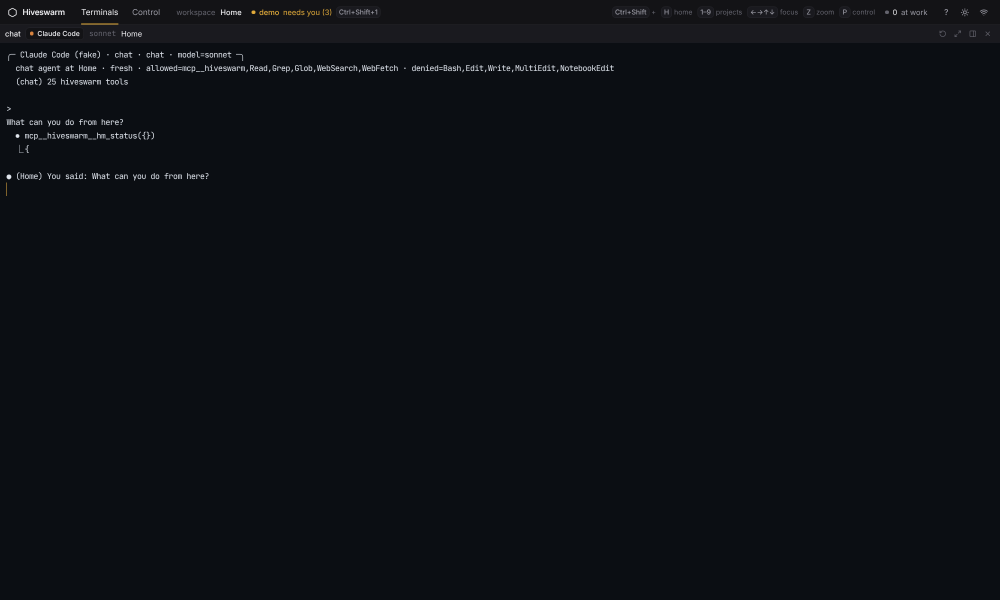
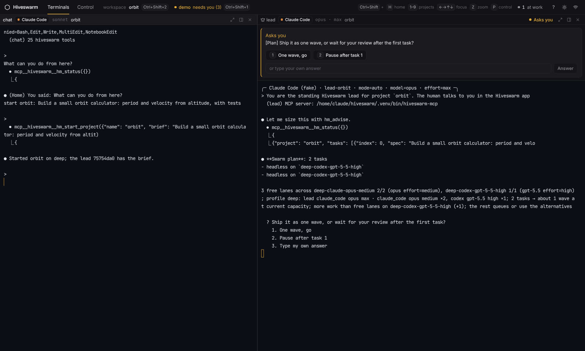
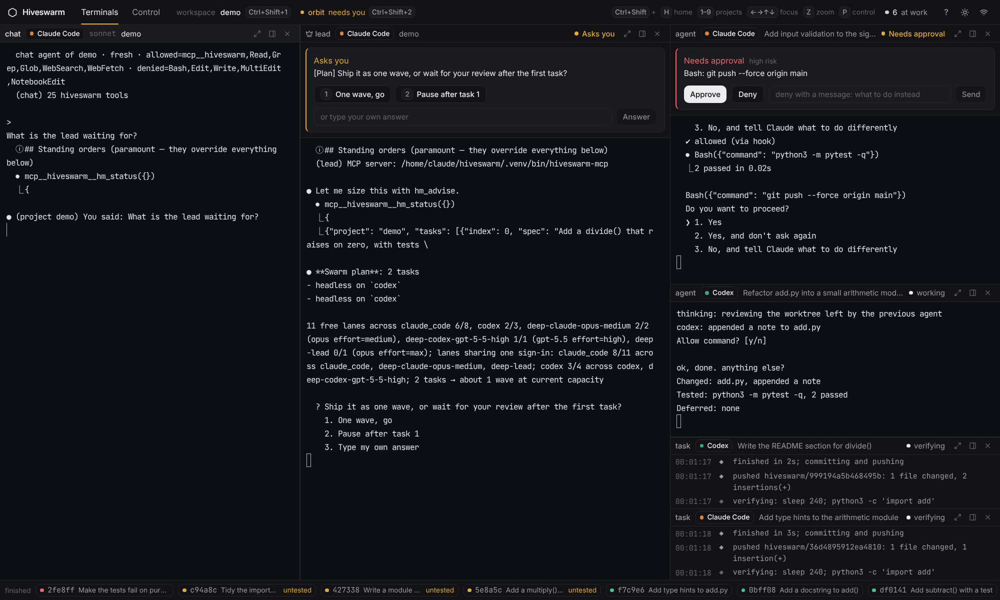
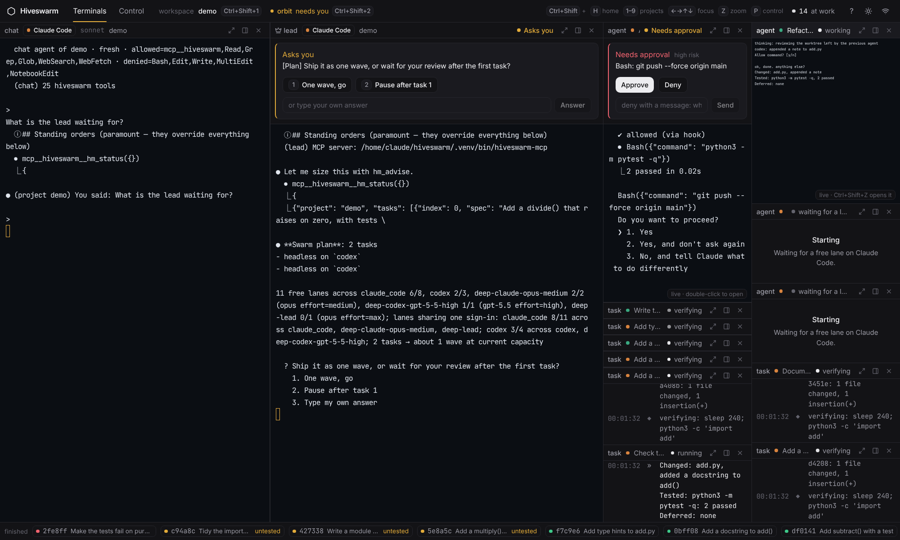
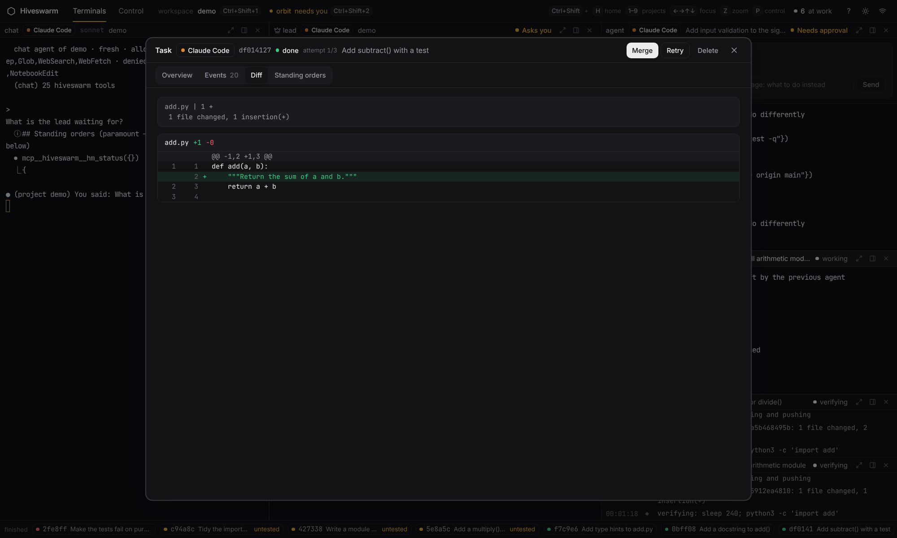
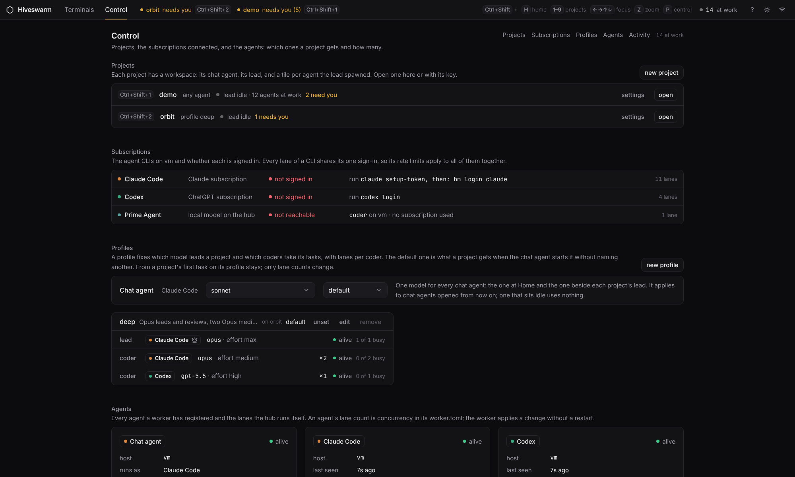

# The app: terminals and the Control tab

The app has two tabs. **Terminals** is the app: real terminals, one workspace at a time. **Control** is everything that is not a terminal.

## Home

The window opens on one terminal: a fresh [chat agent](chat.md). No project is needed to talk to it. Paste a brief and it starts a project; the window follows it into that project's workspace.

## A project's workspace

One per project. From left to right:

- the **chat agent**, your interface to the lead and to the project's progress;
- the **lead**, which plans, spawns the agents, reviews and merges;
- a tile for **every agent the lead spawned**. Each new agent splits the space again.

The splits are weighted, not equal. The chat agent and the lead share most of the window. An agent in its own terminal gets a full tile, headless work a small one that streams its output. A tile that needs you (an approval, a question, a flag) grows and says so in its title line; that panel is the only accent-coloured thing in the workspace. Everything stays viewable:

| | |
|---|---|
| a terminal tile too small to work in | a live miniature of the agent's screen at its real size, scaled down; it never resizes the agent's own terminal |
| more than about eight tiles | the agents' column becomes two, and the quietest headless tiles shrink to their title line |
| a finished agent or task | leaves the tiles and becomes a chip in the strip at the bottom; the chip opens its record (events, diff, merge or retry) |
| an agent on another machine, or a hub lane | a tile with its output as a stream; real terminals exist for agents on the machine the app runs on |

Drag a divider to resize; the size you dragged is kept for that project (double-click a divider to give it back). Double-click a title line, or press <kbd>Ctrl</kbd>+<kbd>Shift</kbd>+<kbd>Z</kbd>, to zoom a tile to the whole workspace and back.

Each tile's title line has three buttons: zoom, details, stop. *Details* opens the agent's record over the workspace: what it was asked, its attempts, its events, its diff, its standing orders, and the actions on it (finish, continue on another agent, merge, retry).

## Keys

A workspace is switched with a key or from the Control tab's project list, nowhere else. Every combination is <kbd>Ctrl</kbd>+<kbd>Shift</kbd>+something, so no key an agent's terminal needs is taken; every other key goes to the terminal that has the focus.

| key | does |
|---|---|
| <kbd>Ctrl</kbd>+<kbd>Shift</kbd>+<kbd>H</kbd> | the Home chat |
| <kbd>Ctrl</kbd>+<kbd>Shift</kbd>+<kbd>1</kbd> … <kbd>9</kbd> | a project's workspace, numbered as on the Control tab |
| <kbd>Ctrl</kbd>+<kbd>Shift</kbd>+<kbd>←</kbd> <kbd>→</kbd> <kbd>↑</kbd> <kbd>↓</kbd> | move focus to the tile on that side |
| <kbd>Ctrl</kbd>+<kbd>Shift</kbd>+<kbd>Z</kbd> | zoom the focused tile, and back |
| <kbd>Ctrl</kbd>+<kbd>Shift</kbd>+<kbd>D</kbd> | details of the focused tile |
| <kbd>Ctrl</kbd>+<kbd>Shift</kbd>+<kbd>P</kbd> | the Control tab, and back |
| <kbd>Shift</kbd>+<kbd>Esc</kbd> | leave a terminal without sending it a key |
| <kbd>Ctrl</kbd>+<kbd>Shift</kbd>+<kbd>C</kbd>, right-click | copy the selection, paste |

The header says which workspace you are in and, when an agent in another one is waiting for you, which one and its key. <kbd>?</kbd> outside a terminal lists the keys.

The chat agent has the keyboard when a workspace opens. Once you type or click anywhere in it, a tile that appears later never takes the keyboard from you. To answer an agent without the mouse, move focus to its tile and answer in its terminal; a miniature becomes the real terminal when you zoom it.

In the desktop app there is no menu on Windows and Linux, so <kbd>Ctrl</kbd>+<kbd>W</kbd>, <kbd>Ctrl</kbd>+<kbd>R</kbd> and the rest reach the terminal; <kbd>F5</kbd> reloads the page and <kbd>F12</kbd> opens the developer tools.

## The Control tab

- **Projects.** Every project with its key, its profile, what it is doing and whether anything in it needs you. *open* goes to its workspace. *settings* holds the rest of a project: its [profile](profiles.md) and lane counts (or its roster when it has no profile), its [ruleset](craft.md), the plan on file, its standing orders, the deferred ledger, where its files are, and removing it. *new project* makes an empty one and opens its workspace.
- **Subscriptions.** The agent CLIs on this machine, whether each is signed in, the command that fixes it when it is not, and how many lanes share that sign-in. Hub lanes (a local model) are listed too.
- **Profiles.** The chat agent's model, and the profiles: which model leads a project and which coders take its tasks, with lanes per coder. One profile can be the default.
- **Agents.** Every agent a worker registered, with its lanes, and this machine's `worker.toml` as a table you can edit.
- **Activity.** Pass rate and timings per agent, the feed of how the agents coordinate, and the history of every task with a filter.

## What changed from 0.3

The Swarm, Lead, Inbox, Hive, Tasks and Stats pages are gone, and so is the New goal dialog. What they did is here: the lead and the sessions are tiles; the inbox is the panel on the tile that needs you (and the header line for other workspaces); the lead's and advisor's chat is the chat agent's terminal; the hive feed, the task list and the stats are the Activity section of the Control tab. Old addresses redirect.
